  
  
  

I build developer tools for AWS and the agents that run on top of it: local emulators, fault injection, agent protocols, and infra that doesn't page you at 3am.

#### 🦀 [rig-contrib](https://github.com/pingedbrain/rig-contrib): Rig, extended

Six companion crates for [Rig](https://github.com/0xPlaygrounds/rig), the Rust LLM framework, all on crates.io and versioned with Rig:

| Crate | What it does |
|---|---|
| [`rig-a2a`](https://crates.io/crates/rig-a2a) | Serve Rig agents over A2A (v1.0 and v0.3 for Strands), call remote A2A agents as tools |
| [`rig-mcp-server`](https://crates.io/crates/rig-mcp-server) | Serve Rig agents and tools over MCP, stdio or Streamable HTTP |
| [`rig-multiagent`](https://crates.io/crates/rig-multiagent) | Swarms that hand off work and graphs of agents: streamed, human-in-the-loop, resumable |
| [`rig-agentcore`](https://crates.io/crates/rig-agentcore) | Run a Rig agent on AWS Bedrock AgentCore Runtime |
| [`rig-otel`](https://crates.io/crates/rig-otel) | OpenTelemetry in one call: spans, GenAI metrics, cross-process traces |
| [`rig-evals`](https://crates.io/crates/rig-evals) | Evaluate agents: datasets, LLM judges, pass-rate gates for CI, JUnit reports |

#### 🧬 Now building: [nf-agents](https://github.com/pingedbrain/nf-agents)

AI agents **inside** Nextflow pipelines, in your own cloud account, with evals and lineage. Rust lineage tooling exposed over MCP, nf-core-compatible agent modules, and `nf-llm-replay` so PR tests need no API keys. Pre-alpha.

#### 📡 Latest pings
<!--PINGS:START-->
- [`ministackorg/ministack`](https://github.com/ministackorg/ministack/pull/2506) feat(s3control): account-level public access block
- [`ministackorg/ministack`](https://github.com/ministackorg/ministack/pull/2435) feat(ssm): documents + automation executions
- [`ministackorg/ministack`](https://github.com/ministackorg/ministack/pull/2489) IAM: service-specific credentials and server certificates
- [`pingedbrain/microburst`](https://github.com/pingedbrain/microburst/pull/20) chore(fidelity): absorb verified-harmless model drift (botocore 1.43.120)
- [`pingedbrain/microburst`](https://github.com/pingedbrain/microburst/pull/19) feat(tls): client-side TLS termination via --tls-cert/--tls-key
<!--PINGS:END-->

Updated daily by a GitHub Action from my merged PRs.

#### ⚙️ Stack

<picture>
  <source media="(prefers-color-scheme: dark)" srcset="https://raw.githubusercontent.com/pingedbrain/pingedbrain/output/snake-dark.svg?v=1" />
  
</picture>
